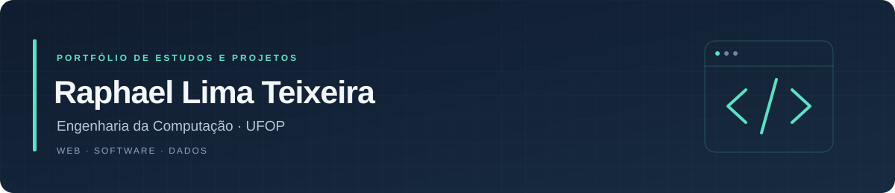

### Estudante de Engenharia da Computação · UFOP

Estou construindo minha base em programação e desenvolvimento web por meio de estudos e projetos práticos. Curso o **4º período de Engenharia da Computação na Universidade Federal de Ouro Preto** — informação atualizada em novembro de 2026.

Moro em **João Monlevade, Minas Gerais**, por conta da graduação.

Busco uma **oportunidade de estágio** para aprender com uma equipe e contribuir em projetos reais. Também tenho interesse em projetos freelance e em colaborar no desenvolvimento de soluções web.

**[LinkedIn](https://www.linkedin.com/in/raphael-lima-teixeira-b65092396/)** · **[E-mail](mailto:rlteixeira084@gmail.com)** · **[Projeto online](https://auto-escola-ouro-editor.vercel.app/)**

---

### Disponibilidade

Tenho preferência por oportunidades **remotas ou híbridas**. Atualmente, minhas aulas são à tarde e tenho disponibilidade **pela manhã e à noite**. Posso avaliar ajustes na grade de aulas para conciliar o estágio e a faculdade.

### O que estou aprendendo

| Tecnologias | Foco de estudo |
| --- | --- |
| **HTML e CSS** | Estrutura de páginas, estilos e interfaces responsivas |
| **JavaScript** | Lógica de programação e interatividade no navegador |
| **TypeScript** | Tipagem e organização do código |

Na graduação, já tive contato com **C, Java e Python**.

Tenho interesse em **front-end, back-end, aplicativos, inteligência artificial, dados e bancos de dados**. Estou explorando essas áreas enquanto aprofundo os fundamentos de programação.

### Projeto em destaque

#### [Editor de Aprovados · Auto Escola Ouro](https://github.com/raphaellimatxr/auto-escola-ouro-editor)

Uma ferramenta web para personalizar artes de aprovação: selecionar uma foto, editar o nome, ajustar o enquadramento e exportar a imagem em PNG.

- **Tecnologias:** HTML, CSS, JavaScript e Canvas.
- **Recursos:** zoom, rotação, reposicionamento da foto e exportação em 1080 × 1080 pixels.
- **Publicação:** Vercel, com acesso pelo navegador do celular ou computador.
- **Desenvolvimento:** com assistência de inteligência artificial, como parte do meu início em projetos web.

**[Testar o editor](https://auto-escola-ouro-editor.vercel.app/)** · **[Ver o código](https://github.com/raphaellimatxr/auto-escola-ouro-editor)**

#### [TrabalhoPraticoAeds2 · Projeto acadêmico em equipe](https://github.com/Caiqueds/TrabalhoPraticoAeds2)

Trabalho acadêmico desenvolvido em equipe, com minha participação registrada no histórico de contribuições do repositório.

**[Ver o projeto da equipe](https://github.com/Caiqueds/TrabalhoPraticoAeds2)**

### Próximos passos

- Fortalecer a base em HTML, CSS, JavaScript e TypeScript.
- Construir novos projetos e registrar aqui minha evolução.
- Ampliar os estudos em aplicações, dados e bancos de dados.
- Evoluir no inglês, atualmente em nível básico. Meu idioma principal é o português.

### Vamos conversar

Estou aberto a conversar sobre **estágios, oportunidades de entrada na área e projetos freelance**.

- **LinkedIn:** [Raphael Lima Teixeira](https://www.linkedin.com/in/raphael-lima-teixeira-b65092396/)
- **E-mail:** [rlteixeira084@gmail.com](mailto:rlteixeira084@gmail.com)
